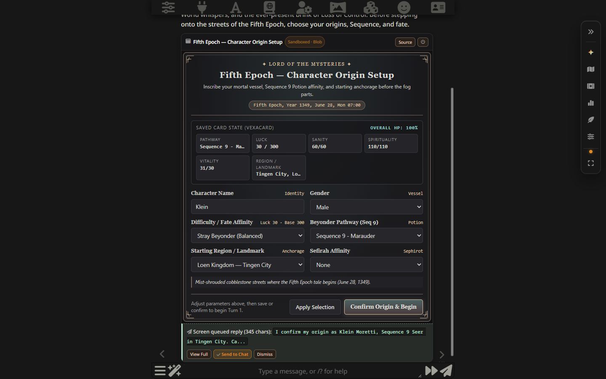
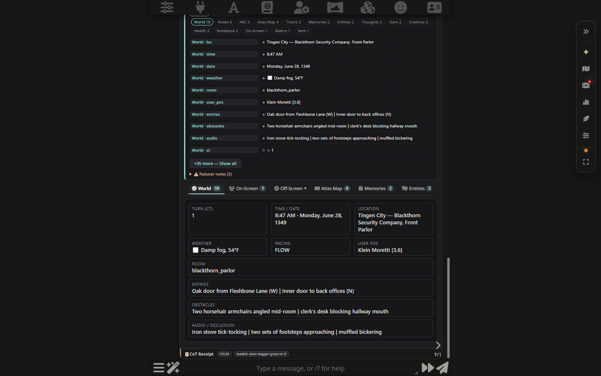
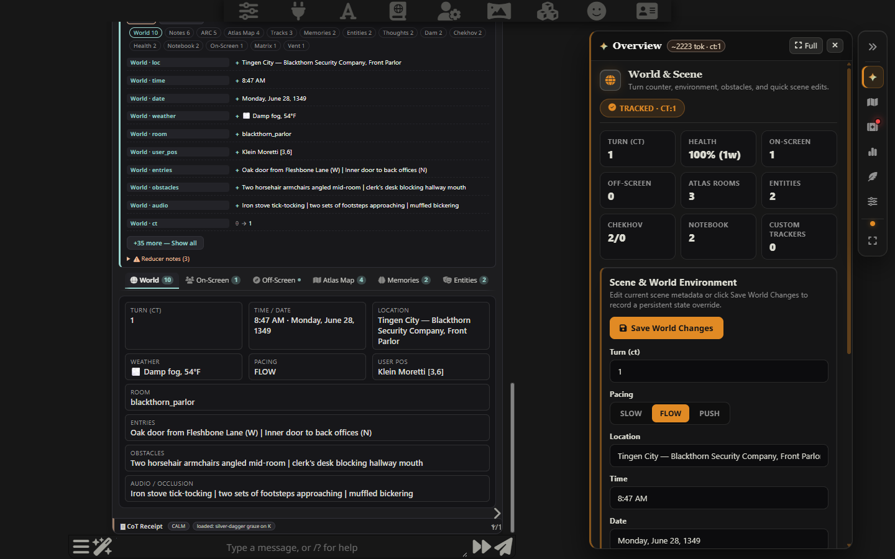
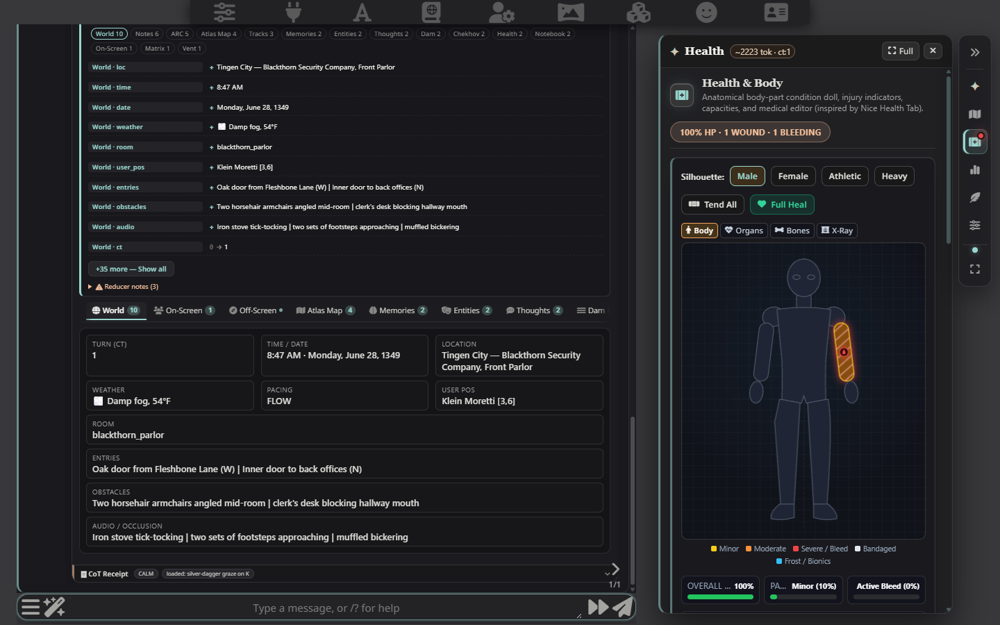
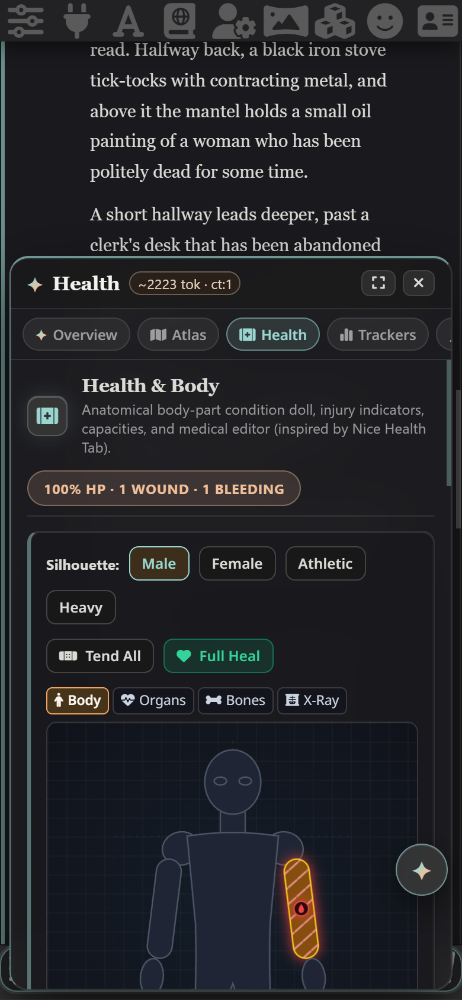
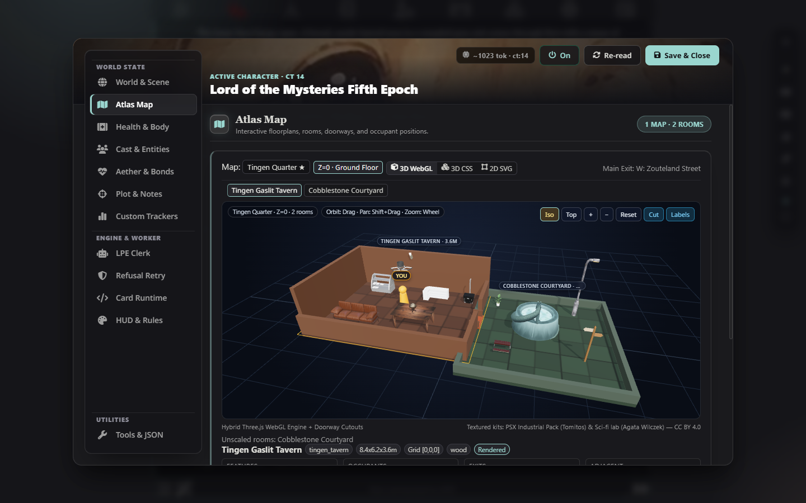

# Lapis Philosophorum Engine (LPE)

External state engine, swipe-safe journaled store, secondary API worker (**LPE Clerk**), Hybrid Three.js WebGL + PolyCSS 3D Atlas map, anatomical health doll, inline editor, and native themed HUD for **Magnum Opus** and Vexa-lineage SillyTavern presets.

# Why Lapis Philosophorum Engine (LPE) & Magnum Opus?
Pure on-the-spot AI generation feels fresh at first, but because models are probabilistic—and players bring consistent habits—similar runs and cards tend to converge. LPE pairs deterministic game structure with controlled uncertainty so playthroughs stay surprising and earned.

## Alpha Release (`v0.1.0-alpha`)

- **Engine, Preset & Theme Identity:** Official release baseline for **Lapis Philosophorum Engine (LPE)** paired with the **Magnum Opus** external-state preset ([`Presets/Magnum Opus.json`](Presets/Magnum%20Opus.json)) and **Magnum Opus Glass** UI theme ([`themes/Magnum_Opus_Glass_Theme.json`](themes/Magnum_Opus_Glass_Theme.json)), while preserving automatic upgrades and aliases for legacy Vexa setups (`vexa_state_engine`, `<vexa_tail>`, `window.VexaCard`, `getvexa()`, `--vse-*`).
- **Tooling & 3D Additions:** Ships with a **24-asset 3D `.glb` library** (`2` bundled CC BY 4.0 packs + `22` standalone CC0 / CC BY 4.0 Sketchfab models), interactive WebGL walkthrough ([`docs/3d-showcase/`](docs/3d-showcase/README.md)), sandboxed card authoring & migration kit ([`templates/lpe-card-template/`](templates/lpe-card-template/README.md)), and Worker-isolated headless EJS validator ([`scripts/verify-ejs-headless.mjs`](scripts/verify-ejs-headless.mjs)).
- **Key Upstream Inspirations:** Built cleanly from architecture and aesthetic inspirations across [`StageDog/tavern_helper_template`](https://github.com/StageDog/tavern_helper_template) (authoring template structure), [`deepsleep-claw/SleepTavernHome`](https://github.com/deepsleep-claw/SleepTavernHome) (vertical side-rail ergonomics), **KAKAA / `@rech0_viixi`** (`双色盒子-深色毛玻璃.json` frosted obsidian + celadon/peach aesthetic), **Ryah** (Vexa preset architecture), **Megumin Suite** (secondary worker & HUD diff workflow), and CC0 / CC BY 4.0 3D asset creators.

<details>
<summary><strong>✦ Features &amp; Live UI Showcase</strong></summary>

### Architecture & Core Capabilities

Vanilla TeleWire/Vexa presets emit all 16 `<internal_states>` XML sections at the end of every reply (~35 KB / ~9k–10k output tokens per turn, ~87% of total output). **Lapis Philosophorum Engine (LPE)** splits that workload into three layers:

1. **Lean Main Model (`<lpe_tail>` + `<!-- GFX_END -->`)**:
   - The main model outputs only `[🕰️ ...]` Time Header, story prose, Colored Dialogue, optional GFX/Props, and a compact terminal `<lpe_tail>` containing `<lpe_receipt>` (`world_sim`, `chekhov`, `arc`, `ooc`) and `<state:vent>` followed by `<!-- GFX_END -->`.
2. **Deterministic JS Engine (`src/reducer.js` + `src/store.js`)**:
   - Stored per chat & branch inside `chat_metadata.lpe_state` with swipe-safe `(lpe_uid, lpe_seq)` stamps.
   - Deterministically handles `ct++`, `<header>` syncing, prose `<color>` locking, Atlas `bbox` calculation + AABB overlap validation + atomic occupant moves, Chekhov `fired` clearing & `age+1` aging, Notebook `[R]` rule pinning & `[R]/[T]/[D]` 20-cap, and Aether Matrix `[3..20]` / `±2` clamping.
   - Includes `importFromChat()` (auto-imports on chat open or one-click button) to migrate existing vanilla `<internal_states>` chats cleanly.
3. **Post-Reply Worker API ("LPE Clerk")**:
   - Runs automatically after the integrated Refusal Auto-Retry guard (or standalone `ST-VexaRefusalAutoRetry`) accepts the reply.
   - Supports **Direct OpenAI-Compatible Endpoints** (via SillyTavern's `ChatCompletionService.processRequest` reverse-proxy path so zero CORS issues) and **SillyTavern Connection Profiles** (`ConnectionManagerRequestService.sendRequest`, zero profile switching).
   - Emits compact JSON deltas (omitting unchanged rooms, dormant NPCs, and unchanged pairs).
4. **Integrated Refusal Auto-Retry & Non-Stream Continue (Toggleable)**:
   - Built directly into **Extensions → Lapis Philosophorum Engine (LPE)** (`Enable built-in Refusal Auto-Retry & End-Marker Guard`), with **Continue (No Stream)** send-bar/options controls, surgical safety-refusal cleanup, end-marker validation (`auto` / `external` / `classic` / `marker`), and custom refusal regex patterns. Standalone `ST-VexaRefusalAutoRetry` is no longer required when this toggle is enabled.
5. **Native JS Tabbed HUD, Unified 3D/2D Atlas & Control Center**:
   - Never mutates `msg.mes`; renders a collapsible themed card under each AI message with a Megumin-inspired inline **"Changed in this reply"** diff strip (`All` / `This tab` filters, clickable section jump badges, per-turn **Revert / Restore**, **Read again**, and reducer notes), a separate collapsible **CoT Receipt** drawer (`world_sim`, `chekhov`, `arc`, `ooc`) positioned cleanly outside/behind `LPE State`, and a one-click **Align All Chat HUDs to Current Theme** action that updates existing chat HUD cards in place.
   - **Shared Atlas Topology & Intra-Level Height (`src/atlasTopology.js`)**: Unifies adjacent touching rooms with flush wall corners, coordinated cutaway heights, **1 unified doorway** (shared texture/style across connected rooms without duplicate outer wall boxes or exit airlocks), vertical ceiling heights (`dim` `WxDxHm`), per-room floor elevation offsets (`elev`), elevated `platform` walkways/mezzanines, and `[x,y,z]` 3D occupant/user positioning, plus an optional toggleable `<spatial_grounding>` prompt guide for the story model.
   - **Hybrid Three.js WebGL Atlas** (`src/atlasWebgl.js`, `src/sketchfabAssets.js`, and vendored `lib/three/`) pairs render-on-demand Three.js rooms and **physical doorway wall cutouts** (`splitWallWithDoorways`, hinged/sliding doors, archways, elevated plinths, and low-curb outdoor courtyards) with normalized **CC BY 4.0** textured `.glb` packs (`assets/models/psx-industrial.glb` & `assets/models/scifi-lab-props.glb`) and **22 standalone CC0 / CC BY 4.0 Sketchfab `.glb` models** (`assets/models/sketchfab-*.glb` — covering sofas, armchairs, oak tables, bar & kitchen counters, antique globes, iron stoves, fountains, park benches, streetlamps, potted plants, signposts, chandeliers, and wall sconces, with runtime bottom-pivot centering, footprint fitting, 90° Y rotation for `kitchen_counter`, elevated mounting for `chandelier`/`wall_sconce`, and `KHR_materials_pbrSpecularGlossiness` material adaptation for `fountain` & `park_bench`), plus original procedural furniture and optional gitignored `assets/models/custom/` local prop overrides.
   - **PolyCSS 3D CSS & Zoomable 2D SVG Atlas** (`src/polyCss3d.js`, `src/polyAssets.js`, `src/atlas3d.js`, `src/atlasSvg.js`) render **10 geometric primitives** and **29 diorama/kit prefabs** (`table`, `chair`, `couch`, `bed`, `bookshelf`, `desk`, `hearth`, `brazier`, `lamp`, `chest`, `tree`, `crystal`, `ladder`, `hourglass`, `container`, `barrel`, `crate`, `dumpster`, `generator`, `pallet`, `propane`, `pipes`, `locker`, `vat`, `console`, `cabinet`, `airlock`, `screen`, `platform`), zoom-invariant projected 3D overlay labels, clipped non-overlapping 2D room titles with pan/zoom `+`/`−`/`Reset` controls and golden-angle crowd decluttering, and **divergent 6-pair Aether Matrix bars** (`src/matrixView.js`) with plain-English `acc`/`E`/`L`/`Gate`/`Wall` explanations.
   - Scaled for long multi-hundred-turn chats via indexed `store.js` timeline/swipe lookups (`O(1)`/`O(log N)`), local single-card HUD refreshes without global version cache-busting, `content-visibility: auto`, and a single lazily loaded WebGL context torn down cleanly on close/tab switch.
   - Includes a draggable floating compass launcher (`#lpe_fab_btn`) and frosted-glass **LPE Control Center** popup (`#lpe_app_overlay`, `.lpe-*`) featuring character banner artwork, left glass dock (collapsible floating pill bar on mobile), live token readout, interactive WebGL/3D/2D Atlas & object builder, state inspection/editing across all tabs, worker & refusal-retry configuration, visual theme swatches, and raw snapshot/JSON tools.
6. **Main-Model-Proposed Custom Trackers (Toggleable)**:
   - When enabled, the main story model can optionally propose recurring multi-field trackers (e.g. a business, estate, ship, or debt ledger) via `tracker_propose:` inside `<lpe_receipt>`.
   - Proposals can be approved/edited/dismissed in 1 click from the HUD or Control Center (or auto-accepted via toggle). Once active, the background worker can only update values of those locked field keys — zero key drift and 0 prompt tokens when no custom trackers exist.
7. **Anatomical Body-Part Health System (Nice Health Tab–Inspired)**:
   - Replaces plain status text with an interactive 27-part anatomical SVG paper doll (`src/healthDoll.js`) supporting 4 silhouettes (`Male`, `Female`, `Athletic`, `Heavy`), 4 inspection layers (`Body`, `Organs`, `Bones`, `X-Ray`), and visual injury indicators (bleeding droplets, bandaged wraps, scars, sharp slashes, burns, frostbite, fractures, toxins/infections, missing parts, and prosthetics).
   - Computes vital gauges (`Overall HP`, `Pain`, `Blood Loss`) and 7 RimWorld-style physiological capacities (`Consciousness`, `Moving`, `Manipulation`, `Breathing`, `Blood Pumping`, `Sight`, `Metabolism`), updated via delta-only `health_delta` worker patches or directly edited in the **Health & Body** Control Center tab (with automatic non-destructive fallback preview from legacy `<state:inv><status>` text).
8. **Clean-Room Scoped EJS Templating & Guarded Blob-URL Card Renderer (Optional / Auto-Yielding)**:
   - **Scoped EJS Engine (`src/ejsEngine.js`)**: Evaluates `<% ... %>` dynamic logic, RPG dice pools (`roll('1d100')`, `chance()`, `pick()`), `getvar`/`setvar` on scoped `card_vars`, `[InitVar]` / `[LPEInitVar]` seeding, and read-only LPE state bindings (`getlpe('health.bloodLoss')`, `lpe.world.loc`, etc.; `getvexa` / `vexa.*` / `{{vexa::...}}` aliases preserved) inside World Info and prompts — isolated from `window`/`document`/secrets and protected by a 5,000-step loop budget. Automatically yields when `ST-Prompt-Template` (`window.EjsTemplate`) is installed.
   - **Guarded Blob-URL Renderer & Sandboxed `postMessage` Bridge (`src/cardRenderer.js` + `src/cardBridge.js`)**: Renders card HTML code blocks in strictly sandboxed (`sandbox="allow-scripts"`, no `allow-same-origin`, `allow-forms`, or `allow-popups`) Blob URL iframes with CSP isolation, per-frame token/source verification, Render Depth throttling, >2 MB size guard, code folding, and `highlight.js` bypass for frontend blocks. Interactive screens use the safe `window.LPECard` bridge (`window.VexaCard` alias preserved) and queue replies through a 1-click confirmation bar instead of accessing `window.parent` or API keys. Automatically yields when `JS-Slash-Runner` (`window.TavernHelper`) is active.

> **Legacy Vexa Compatibility:** Existing configs and chats upgrade automatically without manual steps: `extension_settings.vexa_state_engine` → `extension_settings.lapis_philosophorum_engine`, `chat_metadata.vexa_state` → `chat_metadata.lpe_state`, `(vexa_uid, vexa_seq)` stamps work alongside `(lpe_uid, lpe_seq)`, and parsers/bridges continue accepting `<vexa_tail>`, `<vexa_receipt>`, `window.VexaCard`, `vexa-card-bridge`, `getvexa()`, `{{vexa::...}}`, `[VexaInitVar]`, and `--vse-*`.

### Live E2E Verification Screenshots (Isolated Port `8010`)


*Turn 0 — Sandboxed (`blob:`, `allow-scripts`) Character Origin card UI with seeded `cardVars` and `LPECard` send-confirmation bar.*


*Turn 1 — Live story reply synced by LPE Clerk with expanded inline HUD, "Changed in this reply" diff strip, and collapsed CoT Receipt.*


*Desktop Side-Rail & Drawer (`1440×900`) — Non-overlapping vertical `#lpe_rail` and frosted `#lpe_drawer` open on Overview.*


*Magnum Opus Glass & Health Doll — Dual celadon/peach frosted UI theme alongside live-extracted anatomical injury tracking.*


*Mobile Bottom-Sheet (`390×844`) — Responsive narrow-viewport drawer, horizontal tab strip, and floating `#lpe_fab_btn` with zero overflow.*


*Hybrid Three.js WebGL Atlas — Multi-room Tingen Quarter with unified doorway cutout and 13 normalized Sketchfab GLB props.*

</details>

## Preset Setup

The companion external-state preset (**Magnum Opus**, [`Presets/Magnum Opus.json`](Presets/Magnum%20Opus.json)) is **included directly in this repository with Ryah's permission**:

1. Import [`Presets/Magnum Opus.json`](Presets/Magnum%20Opus.json) under SillyTavern's **AI Response Configuration** (or turn on **Force Active on Non-LPE / Magnum Opus Presets** to inject external state on other presets).
   > **Note for Sandboxed HTML Card UIs:** When prompted by SillyTavern to allow embedded preset regex scripts (or under Extensions → Regex), keep **`Old Codeblock Cleaner`** disabled so markdown ```` ```html ```` code blocks remain intact for `src/cardRenderer.js`.
2. If you want to build `Presets/Magnum Opus.json` from your own upstream Vexa preset (`https://ryah.github.io/vexa/`), run the local conversion helper:
   ```bash
   node scripts/build-preset.mjs /path/to/your-vexa-preset.json Presets/Magnum\ Opus.json
   ```

See [`docs/card-adaptation/`](docs/card-adaptation/01-overview-and-offloading.md) for the full card-conversion & scripting playbook.

Build and preview sandboxed card panels with the [LPE Card Authoring Kit](templates/lpe-card-template/README.md). For existing cards, follow the [migration workflow](templates/lpe-card-template/migration/MIGRATION_WORKFLOW.md) and run the [headless EJS validator](scripts/verify-ejs-headless.mjs).

## UI & Companion Theme (`Magnum Opus Glass`)

LPE ships with a native dual-accent dark frosted-glass design system (`.lpe-*`) and an optional companion SillyTavern UI Theme preset:

- **Collapsible Vertical Side-Rail & Slide-Out Drawer (`>= 1000px`)**: `#lpe_rail` docks beside the SillyTavern chat viewport (`6` quick tabs: `Overview`, `Atlas`, `Health`, `Trackers & Vars`, `Journal & Chekhov`, `Settings`, plus a `✦` HUD pulse & collapse toggle) and opens a frosted `#lpe_drawer` panel without obstructing `#top-bar`, `#left-nav-panel`, `#right-nav-panel`, or the chat composer. When collapsed, the floating `#lpe_fab_btn` (`✦`) reappears.
- **Mobile Bottom-Sheet Mode (`< 1000px`)**: Hides the side-rail cleanly and turns `#lpe_fab_btn` into a `76dvh` frosted bottom-sheet drawer toggle with horizontal sub-tabs.
- **SmartTheme Variable Inheritance**: `.lpe-*` surfaces inherit SillyTavern's `--SmartThemeBlurTintColor`, `--SmartThemeBorderColor`, `--SmartThemeShadowColor`, `--SmartThemeBodyColor`, `--SmartThemeEmColor`, `--SmartThemeQuoteColor`, and `--SmartThemeUnderlineColor` dynamically (falling back to the obsidian `#1D1D20` + celadon `#9AD6CF` + gilded peach `#F1BE9A` **Magnum Opus** palette). Zero external font or asset CDNs are loaded.
- **Optional Companion SillyTavern UI Theme**: Import [`themes/Magnum_Opus_Glass_Theme.json`](themes/Magnum_Opus_Glass_Theme.json) under SillyTavern **User Settings (A) → UI Theme → Import** to match chat bubbles, `#send_form`, drawers, and scrollbars to **Magnum Opus Glass**.

## Interactive 3D Showcase (`docs/3d-showcase/`)

Explore the standalone [Tingen Quarter WebGL walkthrough](docs/3d-showcase/README.md) featuring camera presets, lighting moods, floor-grounded props (`sci_jar` flush at `y = 0`), click-to-inspect raycasting, and CC BY 4.0 / CC0 attribution:

- **GitHub Pages URL:** **https://250000000001.github.io/ST-LapisPhilosophorumEngine/docs/3d-showcase/** (deployed from branch `main` with `/ (root)` so `../../assets/models/` and `../../lib/three/` resolve cleanly).
- **Custom Domains & WordPress Articles:** A custom subdomain pointed at GitHub Pages via DNS `CNAME` (e.g., `lpe.xuweijiedev.com`) serves the showcase from `https://lpe.xuweijiedev.com/docs/3d-showcase/`, while companion WordPress posts/drafts (such as `https://xuweijiedev.com/?p=1565`) link out to or embed the GitHub Pages / custom-subdomain URL in an `<iframe>` instead of re-uploading `.glb` binaries to WordPress media.
- **Run Locally Over HTTP:** Serve from the **repository root** over a static HTTP server (e.g., `python -m http.server 8099` → `http://localhost:8099/docs/3d-showcase/`, or an ephemeral port) — **never** open directly via `file://` (ES module & GLB CORS restrictions) and **never** use port `8000`.

## Testing

- **Offline Unit & Integration Suite:** Run `node --test test/*.test.mjs` inside the repository root to verify reducer determinism, swipe journal isolation, topology/matrix diffs, and 3D WebGL/Health doll helpers without network calls.
- **Headless Card EJS Validation:** Run `node scripts/verify-ejs-headless.mjs path/to/card.png --json` inside the repository root to verify `[InitVar]` seeding and EJS evaluation across turns `0–2` in an isolated Node `worker_threads` sandbox.
- **Isolated Live E2E Verification (Port `8010`):** Launch a separate local SillyTavern test copy on an isolated port (`node server.js --port 8010 --browserLaunchEnabled false --listen false`) so any personal SillyTavern instance on port `8000` remains untouched. Read test API credentials strictly in memory at runtime from an untracked local file outside the repo (for example `Projects/Test-playground/LPE_TEST_API_KEY.txt`), run temporary CDP/Playwright verification harnesses under `_tmp/` (deleted after completion), and restore/scrub temporary `settings.json`, `secrets.json`, chats, presets, and imported characters inside `finally` without logging or committing tokens.

<details>
<summary><strong>✦ 3D Asset Library, Licenses &amp; Credits</strong></summary>

### 3D Asset Library & Fetch Pipeline

- **Bundled Packs & Standalone Imports (`assets/models/*.glb`)**: Combines `2` bundled CC BY 4.0 packs (`psx-industrial.glb` and `scifi-lab-props.glb`) with `22` standalone CC0 / CC BY 4.0 Sketchfab `.glb` models (`sketchfab-*.glb`) indexed in [`src/sketchfabAssets.js`](src/sketchfabAssets.js). Full model credits, UIDs, licenses, and adaptation notes are tracked in [`assets/models/ATTRIBUTION.md`](assets/models/ATTRIBUTION.md).
- **Curated Manifest & Fetch Script**: [`scripts/sketchfab-general-mix.json`](scripts/sketchfab-general-mix.json) defines curated slots and target dimensions, while [`scripts/fetch-sketchfab-assets.mjs`](scripts/fetch-sketchfab-assets.mjs) fetches permitted CC0 / CC BY Sketchfab GLBs, updates [`src/sketchfabAssets.js`](src/sketchfabAssets.js), and regenerates the standalone credit entries in [`assets/models/ATTRIBUTION.md`](assets/models/ATTRIBUTION.md).
- **Runtime Normalization (`src/atlasWebgl.js`)**: Automatically centers bottom pivots, fits prop footprints (`bar_counter`, `park_bench`), applies `kitchen_counter`'s 90° Y-axis rotation (`preRotY`), elevates wall/ceiling fixtures (`chandelier` at `z = 2.55`, `wall_sconce` at `z = 1.95`), grounds floor-bound fixtures (`sci_jar` flush at `y = 0`), and adapts legacy `KHR_materials_pbrSpecularGlossiness` materials (`fountain`, `park_bench`) for standard glTF/Three.js PBR lighting.

### Credits & Acknowledgements

- **Magnum Opus Glass UI & Side-Rail Inspiration**:
  - Inspired by the dark frosted obsidian + dual celadon/peach palette of **KAKAA / `@rech0_viixi`** (`双色盒子-深色毛玻璃.json`, [CC BY-NC-SA 4.0](https://creativecommons.org/licenses/by-nc-sa/4.0/)) and the slim vertical sidebar ergonomics of **`deepsleep-claw/SleepTavernHome`** ([Aladdin Free Public License v9](https://github.com/deepsleep-claw/SleepTavernHome)). Both `style.css` (`.lpe-*` / `#lpe_rail` / `#lpe_drawer`) and [`themes/Magnum_Opus_Glass_Theme.json`](themes/Magnum_Opus_Glass_Theme.json) are 100% original clean-room implementations with zero third-party CSS copy-pasting and zero external CDN dependencies.
- **LPE Card Authoring Kit Inspiration**:
  - Separated source/build layout, TypeScript declarations (`types/lpe-card.d.ts`), and local preview workflow in [`templates/lpe-card-template/`](templates/lpe-card-template/README.md) draw architectural inspiration from **`StageDog/tavern_helper_template`** ([PolyForm Noncommercial License 1.0.0](https://github.com/StageDog/tavern_helper_template)). The LPE template and sandboxed `window.LPECard` bridge are original clean-room implementations.
- **Vexa Preset** by **Ryah** — https://ryah.github.io/vexa
  - Created the TeleWire TRP-AO world-simulation preset, 16-section `<internal_states>` architecture, Aether Matrix/Dam, Atlas, Chekhov, ARC, and HUD theme palettes that Lapis Philosophorum Engine (LPE) & **Magnum Opus** externalize and build upon. The **Magnum Opus** external-state preset included under [`Presets/`](Presets/) is derived from Ryah's Vexa preset and redistributed with Ryah's explicit permission.
- **Megumin Suite** by **Arif-salah (`KazumaONIISAN`)** — https://github.com/Arif-salah/Megumin-Suite
  - Inspired the Chomusuke secondary worker API workflow, swipe-safe journaled state store, send-guard flow, and the floating launcher + frosted-glass Control Center UI (`src/appPopup.js` & `style.css`).
- **PolyCSS** & **css.graphics** by **alowpoly (Agustin Capeletto / LayoutIt)** — https://github.com/layoutit/polycss · https://github.com/layoutit/css.graphics
  - Inspired the pure CSS `matrix3d(...)` 3D polygon projection, solid-quad optimization, and modular DOM 3D asset packaging in `src/polyCss3d.js` and `src/polyAssets.js`.
- **3D-Room** by **BhaskarAcharjee** — https://github.com/BhaskarAcharjee/3D-Room
  - Inspired the isometric CSS 3D diorama room plinths, soft ground contact shadows, and ambient radial floor lighting aesthetics in `src/atlas3d.js` and `src/polyAssets.js` (original implementation).
- **Nice Health Tab (RimWorld Mod)** by **Andromeda** — https://steamcommunity.com/sharedfiles/filedetails/?id=3328729902
  - Inspired the anatomical paper-doll health display, body-part injury/bandage/scar visualization, organ/bone layers, and physiological capacity breakdown in `src/healthDoll.js`. All SVG vectors, patterns, and UI code in this extension are original implementations.
- **JS-Slash-Runner** by **N0VI028** — https://github.com/N0VI028/JS-Slash-Runner
  - Inspired the Blob-URL frontend iframe rendering concept, Render Depth throttling, code-block folding, and `highlight.js` bypass for frontend screens in `src/cardRenderer.js`. All renderer, CSP, and sandboxed `postMessage` bridge code (`src/cardRenderer.js`, `src/cardBridge.js`) is an original clean-room implementation under CC BY-NC 4.0 with zero upstream code copied.
- **ST-Prompt-Template** by **zonde306** — https://github.com/zonde306/ST-Prompt-Template
  - Inspired the Embedded JavaScript (EJS) prompt/World Info evaluation, `[InitVar]` seeding, `getvar` helpers, and dynamic card-variable concepts in `src/ejsEngine.js`. All compiler, safety-scanner, loop-budget, and runtime evaluation code in `src/ejsEngine.js` is an original clean-room implementation under CC BY-NC 4.0 with zero upstream code copied.
- **Three.js** (`0.187.0`) by **Three.js Authors** — https://threejs.org/
  - Vendored ES modules under [`lib/three/`](lib/three/LICENSE) (MIT License) powering the Hybrid WebGL Atlas renderer (`src/atlasWebgl.js`).
- **PSX Industrial Pack** (`assets/models/psx-industrial.glb`) by **Tomitos** (https://sketchfab.com/Tomitos_) — https://sketchfab.com/3d-models/psx-industrial-pack-12cb749961974f94a4063e67dafb2d76
  - Licensed under [Creative Commons Attribution 4.0 International (CC BY 4.0)](https://creativecommons.org/licenses/by/4.0/). Changes made: extracted individual prop meshes from source `industrial.fbx`, baked transforms, normalized bounds and pivots to `(0, 0, 0)`, converted embedded `512×512` `T_Industrial` / `T_Industrial2` diffuse textures to WebP, and packaged as `assets/models/psx-industrial.glb` (see [`assets/models/ATTRIBUTION.md`](assets/models/ATTRIBUTION.md)).
- **Sci-fi lab** (`assets/models/scifi-lab-props.glb`) by **Agata Wilczek** (https://sketchfab.com/a_wilczek) — https://sketchfab.com/3d-models/sci-fi-lab-a676e149e343403bb5e57686f3d31da5
  - Licensed under [Creative Commons Attribution 4.0 International (CC BY 4.0)](https://creativecommons.org/licenses/by/4.0/). Changes made: isolated 8 modular interior props (`sci_vat`, `sci_console`, `sci_table`, `sci_jar`, `sci_cabinet`, `sci_airlock`, `sci_screen`, `sci_pipe`) from `enviro_lab.obj`, decimated geometry via UV-preserving vertex clustering, added glowing cyan/emissive containment glass styling, converted/downscaled textures to WebP, normalized pivots, and packaged as `assets/models/scifi-lab-props.glb` (see [`assets/models/ATTRIBUTION.md`](assets/models/ATTRIBUTION.md)).
- **Standalone Sketchfab Props (`22` CC0 / CC BY 4.0 `.glb` Models):** Credited individually by author, Sketchfab UID, source URL, and license in [`assets/models/ATTRIBUTION.md`](assets/models/ATTRIBUTION.md).

### License

- **Extension Code & Procedural 3D Geometry:** All original JavaScript, CSS, HTML, procedural Three.js/PolyCSS builders, and tooling scripts in this repository are licensed under **[Creative Commons Attribution-NonCommercial 4.0 International (CC BY-NC 4.0)](LICENSE)**.
- **Magnum Opus Preset (`Presets/Magnum Opus.json`):** Derived from Ryah's Vexa preset (`https://ryah.github.io/vexa`) and included with Ryah's permission for SillyTavern LPE users.
- **Vendored Three.js (`lib/three/`):** Licensed separately under the **[MIT License](lib/three/LICENSE)**.
- **3D Model Assets (`assets/models/*.glb`):** Bundled industrial & sci-fi packs are licensed under **[Creative Commons Attribution 4.0 International (CC BY 4.0)](https://creativecommons.org/licenses/by/4.0/)**, and standalone Sketchfab imports carry their individual **CC0 1.0** or **CC BY 4.0** terms as detailed in [`assets/models/ATTRIBUTION.md`](assets/models/ATTRIBUTION.md). No endorsement by original model authors is implied.

</details>
