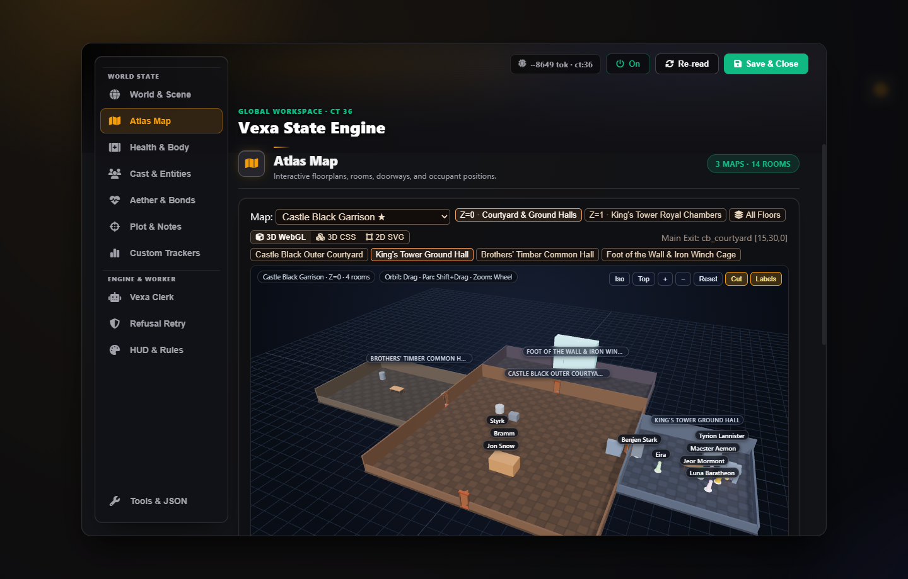
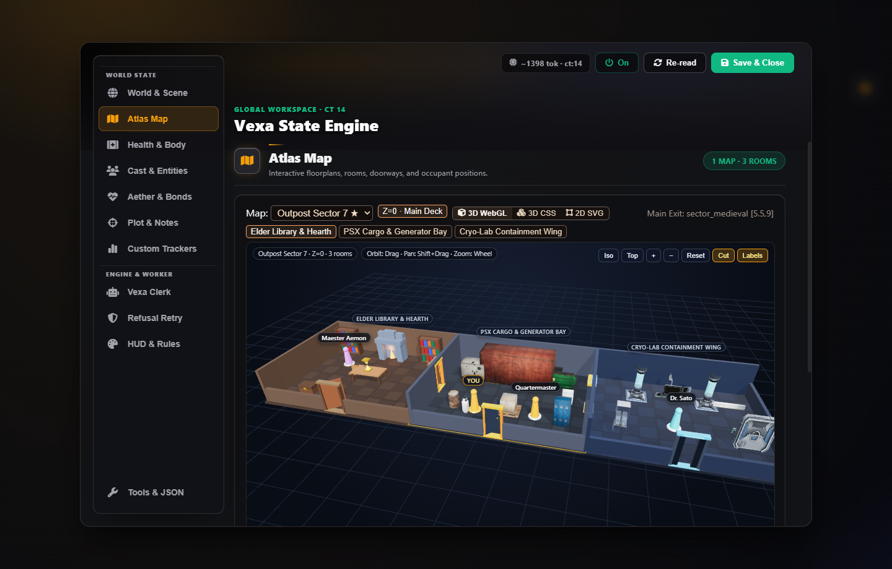
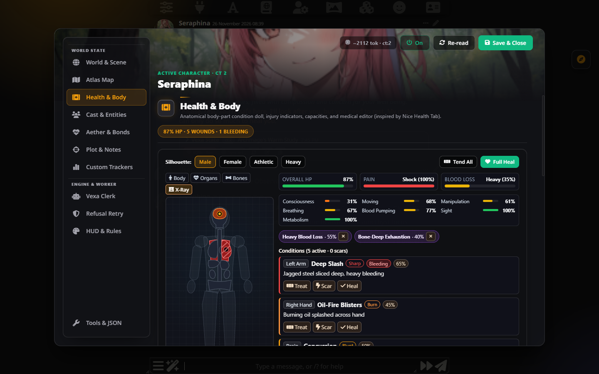
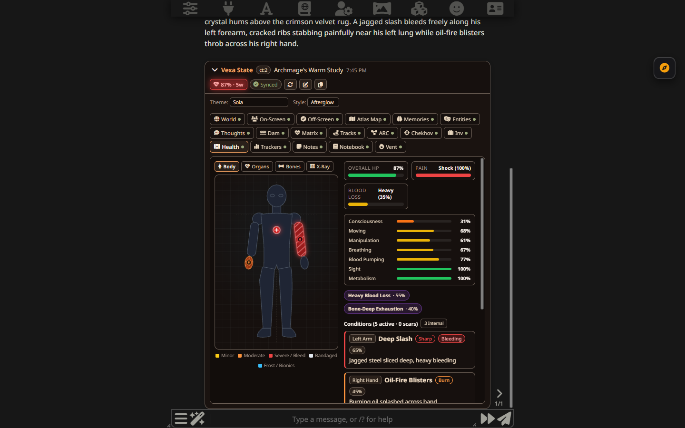
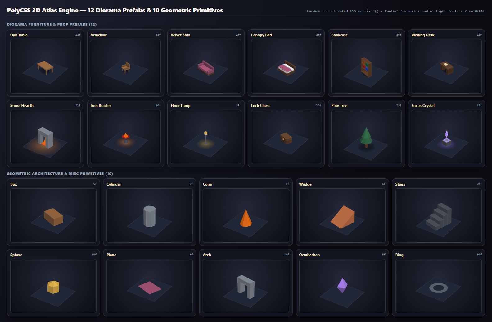
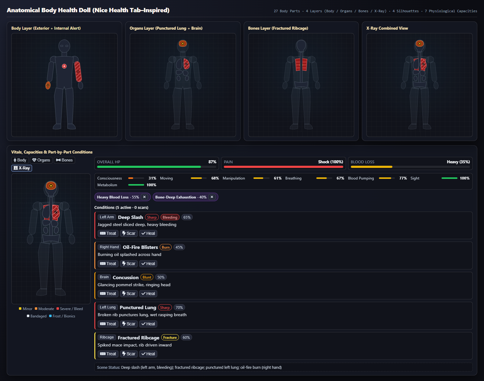

# ST-VexaStateEngine

External state engine, swipe-safe journaled store, secondary API worker ("Vexa Clerk"), Hybrid Three.js WebGL + PolyCSS 3D Atlas map, anatomical health doll, inline editor, and native themed HUD for SillyTavern Vexa presets.

## Screenshots

<p align="center">
  
  
</p>
<p align="center">
  
  
</p>
<p align="center">
  
  
</p>

## What It Does

Vanilla Vexa emits all 16 `<internal_states>` XML sections at the end of every reply (~35 KB / ~9k–10k output tokens per turn, ~87% of total output). **Vexa State Engine** splits that workload into three layers:

1. **Lean Main Model (`<vexa_tail>` + `<!-- GFX_END -->`)**:
   - The main model outputs only `[🕰️ ...]` Time Header, story prose, Colored Dialogue, optional GFX/Props, and a compact terminal `<vexa_tail>` containing `<vexa_receipt>` (`world_sim`, `chekhov`, `arc`, `ooc`) and `<state:vent>` followed by `<!-- GFX_END -->`.
2. **Deterministic JS Engine (`src/reducer.js` + `src/store.js`)**:
   - Stored per chat & branch inside `chat_metadata.vexa_state` with swipe-safe `(vexa_uid, vexa_seq)` stamps.
   - Deterministically handles `ct++`, `<header>` syncing, prose `<color>` locking, Atlas `bbox` calculation + AABB overlap validation + atomic occupant moves, Chekhov `fired` clearing & `age+1` aging, Notebook `[R]` rule pinning & `[R]/[T]/[D]` 20-cap, and Aether Matrix `[3..20]` / `±2` clamping.
   - Includes `importFromChat()` (auto-imports on chat open or one-click button) to migrate existing vanilla Vexa chats cleanly.
3. **Post-Reply Worker API ("Vexa Clerk")**:
   - Runs automatically after the integrated Refusal Auto-Retry guard (or standalone `ST-VexaRefusalAutoRetry`) accepts the reply.
   - Supports **Direct OpenAI-Compatible Endpoints** (via SillyTavern's `ChatCompletionService.processRequest` reverse-proxy path so zero CORS issues) and **SillyTavern Connection Profiles** (`ConnectionManagerRequestService.sendRequest`, zero profile switching).
   - Emits compact JSON deltas (omitting unchanged rooms, dormant NPCs, and unchanged pairs).
4. **Integrated Refusal Auto-Retry & Non-Stream Continue (Toggleable)**:
   - Built directly into **Extensions → Vexa State Engine** (`Enable built-in Refusal Auto-Retry & End-Marker Guard`), with **Continue (No Stream)** send-bar/options controls, surgical safety-refusal cleanup, end-marker validation (`auto` / `external` / `classic` / `marker`), and custom refusal regex patterns. Standalone `ST-VexaRefusalAutoRetry` is no longer required when this toggle is enabled.
5. **Native JS Tabbed HUD, Unified 3D/2D Atlas & Control Center**:
   - Never mutates `msg.mes`; renders a collapsible themed card under each AI message with a Megumin-inspired inline **"Changed in this reply"** diff strip (`All` / `This tab` filters, clickable section jump badges, per-turn **Revert / Restore**, **Read again**, and reducer notes), a separate collapsible **CoT Receipt** drawer (`world_sim`, `chekhov`, `arc`, `ooc`) positioned cleanly outside/behind `Vexa State`, and a one-click **Align All Chat HUDs to Current Theme** action that updates existing chat HUD cards in place.
   - **Shared Atlas Topology & Intra-Level Height (`src/atlasTopology.js`)**: Unifies adjacent touching rooms with flush wall corners, coordinated cutaway heights, **1 unified doorway** (shared texture/style across connected rooms without duplicate outer wall boxes or exit airlocks), vertical ceiling heights (`dim` `WxDxHm`), per-room floor elevation offsets (`elev`), elevated `platform` walkways/mezzanines, and `[x,y,z]` 3D occupant/user positioning, plus an optional toggleable `<spatial_grounding>` prompt guide for the story model.
   - **Hybrid Three.js WebGL Atlas** (`src/atlasWebgl.js` + vendored `lib/three/`) pairs render-on-demand Three.js rooms and **physical doorway wall cutouts** (`splitWallWithDoorways`, hinged/sliding doors, archways, elevated plinths, and low-curb outdoor courtyards) with normalized **CC BY 4.0** textured `.glb` packs (`assets/models/psx-industrial.glb` & `assets/models/scifi-lab-props.glb`) and original procedural furniture — plus optional gitignored `assets/models/custom/` local prop overrides.
   - **PolyCSS 3D CSS & Zoomable 2D SVG Atlas** (`src/polyCss3d.js`, `src/polyAssets.js`, `src/atlas3d.js`, `src/atlasSvg.js`) render **10 geometric primitives** and **29 diorama/kit prefabs** (`table`, `chair`, `couch`, `bed`, `bookshelf`, `desk`, `hearth`, `brazier`, `lamp`, `chest`, `tree`, `crystal`, `ladder`, `hourglass`, `container`, `barrel`, `crate`, `dumpster`, `generator`, `pallet`, `propane`, `pipes`, `locker`, `vat`, `console`, `cabinet`, `airlock`, `screen`, `platform`), zoom-invariant projected 3D overlay labels, clipped non-overlapping 2D room titles with pan/zoom `+`/`−`/`Reset` controls and golden-angle crowd decluttering, and **divergent 6-pair Aether Matrix bars** (`src/matrixView.js`) with plain-English `acc`/`E`/`L`/`Gate`/`Wall` explanations.
   - Scaled for long multi-hundred-turn chats via indexed `store.js` timeline/swipe lookups (`O(1)`/`O(log N)`), local single-card HUD refreshes without global version cache-busting, `content-visibility: auto`, and a single lazily loaded WebGL context torn down cleanly on close/tab switch.
   - Includes a draggable floating compass launcher (`#vse_fab_btn`) and frosted-glass **Vexa Control Center** popup (`#vse_app_overlay`) featuring character banner artwork, left glass dock (collapsible floating pill bar on mobile), live token readout, interactive WebGL/3D/2D Atlas & object builder, state inspection/editing across all tabs, worker & refusal-retry configuration, visual theme swatches, and raw snapshot/JSON tools.
6. **Main-Model-Proposed Custom Trackers (Toggleable)**:
   - When enabled, the main story model can optionally propose recurring multi-field trackers (e.g. a business, estate, ship, or debt ledger) via `tracker_propose:` inside `<vexa_receipt>`.
   - Proposals can be approved/edited/dismissed in 1 click from the HUD or Control Center (or auto-accepted via toggle). Once active, the background worker can only update values of those locked field keys — zero key drift and 0 prompt tokens when no custom trackers exist.
7. **Anatomical Body-Part Health System (Nice Health Tab–Inspired)**:
   - Replaces plain status text with an interactive 27-part anatomical SVG paper doll (`src/healthDoll.js`) supporting 4 silhouettes (`Male`, `Female`, `Athletic`, `Heavy`), 4 inspection layers (`Body`, `Organs`, `Bones`, `X-Ray`), and visual injury indicators (bleeding droplets, bandaged wraps, scars, sharp slashes, burns, frostbite, fractures, toxins/infections, missing parts, and prosthetics).
   - Computes vital gauges (`Overall HP`, `Pain`, `Blood Loss`) and 7 RimWorld-style physiological capacities (`Consciousness`, `Moving`, `Manipulation`, `Breathing`, `Blood Pumping`, `Sight`, `Metabolism`), updated via delta-only `health_delta` worker patches or directly edited in the **Health & Body** Control Center tab (with automatic non-destructive fallback preview from legacy `<state:inv><status>` text).

## Preset Setup

Ryah's Vexa preset JSON files are **not redistributed** in this repository. To generate an External-State preset locally:

1. Obtain your copy of Vexa directly from Ryah's project (`https://ryah.github.io/vexa/`).
2. Run the local conversion helper:
   ```bash
   node scripts/build-preset.mjs /path/to/your-vexa-preset.json /path/to/output-external-state-preset.json
   ```
3. Import the generated `- External State.json` file into SillyTavern (even without converting first, turning on **Force Active on Non-Vexa Presets** or using Vexa auto-detection activates prompt stripping & snapshot injection).

## Credits & Acknowledgements

- **Vexa Preset** by **Ryah** — https://ryah.github.io/vexa
  - Created the TeleWire TRP-AO world-simulation preset, 16-section `<internal_states>` architecture, Aether Matrix/Dam, Atlas, Chekhov, ARC, and HUD theme palettes that this engine externalizes and builds upon.
- **Megumin Suite** by **Arif-salah (`KazumaONIISAN`)** — https://github.com/Arif-salah/Megumin-Suite
  - Inspired the Chomusuke secondary worker API workflow, swipe-safe journaled state store, send-guard flow, and the floating launcher + frosted-glass Control Center UI (`src/appPopup.js` & `style.css`).
- **PolyCSS** & **css.graphics** by **alowpoly (Agustin Capeletto / LayoutIt)** — https://github.com/layoutit/polycss · https://github.com/layoutit/css.graphics
  - Inspired the pure CSS `matrix3d(...)` 3D polygon projection, solid-quad optimization, and modular DOM 3D asset packaging in `src/polyCss3d.js` and `src/polyAssets.js`.
- **3D-Room** by **BhaskarAcharjee** — https://github.com/BhaskarAcharjee/3D-Room
  - Inspired the isometric CSS 3D diorama room plinths, soft ground contact shadows, and ambient radial floor lighting aesthetics in `src/atlas3d.js` and `src/polyAssets.js` (original implementation).
- **Nice Health Tab (RimWorld Mod)** by **Andromeda** — https://steamcommunity.com/sharedfiles/filedetails/?id=3328729902
  - Inspired the anatomical paper-doll health display, body-part injury/bandage/scar visualization, organ/bone layers, and physiological capacity breakdown in `src/healthDoll.js`. All SVG vectors, patterns, and UI code in this extension are original implementations.
- **Three.js** (`0.187.0`) by **Three.js Authors** — https://threejs.org/
  - Vendored ES modules under [`lib/three/`](lib/three/LICENSE) (MIT License) powering the Hybrid WebGL Atlas renderer (`src/atlasWebgl.js`).
- **PSX Industrial Pack** (`assets/models/psx-industrial.glb`) by **Tomitos** (https://sketchfab.com/Tomitos_) — https://sketchfab.com/3d-models/psx-industrial-pack-12cb749961974f94a4063e67dafb2d76
  - Licensed under [Creative Commons Attribution 4.0 International (CC BY 4.0)](https://creativecommons.org/licenses/by/4.0/). Changes made: extracted individual prop meshes from source `industrial.fbx`, baked transforms, normalized bounds and pivots to `(0, 0, 0)`, converted embedded `512×512` `T_Industrial` / `T_Industrial2` diffuse textures to WebP, and packaged as `assets/models/psx-industrial.glb` (see [`assets/models/ATTRIBUTION.md`](assets/models/ATTRIBUTION.md)).
- **Sci-fi lab** (`assets/models/scifi-lab-props.glb`) by **Agata Wilczek** (https://sketchfab.com/a_wilczek) — https://sketchfab.com/3d-models/sci-fi-lab-a676e149e343403bb5e57686f3d31da5
  - Licensed under [Creative Commons Attribution 4.0 International (CC BY 4.0)](https://creativecommons.org/licenses/by/4.0/). Changes made: isolated 8 modular interior props (`sci_vat`, `sci_console`, `sci_table`, `sci_jar`, `sci_cabinet`, `sci_airlock`, `sci_screen`, `sci_pipe`) from `enviro_lab.obj`, decimated geometry via UV-preserving vertex clustering, added glowing cyan/emissive containment glass styling, converted/downscaled textures to WebP, normalized pivots, and packaged as `assets/models/scifi-lab-props.glb` (see [`assets/models/ATTRIBUTION.md`](assets/models/ATTRIBUTION.md)).

## License

- **Extension Code & Procedural 3D Geometry:** All original JavaScript, CSS, HTML, procedural Three.js/PolyCSS builders, and tooling scripts in this repository are licensed under **[Creative Commons Attribution-NonCommercial 4.0 International (CC BY-NC 4.0)](LICENSE)**.
- **Vendored Three.js (`lib/three/`):** Licensed separately under the **[MIT License](lib/three/LICENSE)**.
- **Bundled 3D Model Assets (`assets/models/*.glb`):** Licensed under **[Creative Commons Attribution 4.0 International (CC BY 4.0)](https://creativecommons.org/licenses/by/4.0/)** as detailed in [`assets/models/ATTRIBUTION.md`](assets/models/ATTRIBUTION.md). No endorsement by original model authors is implied.
